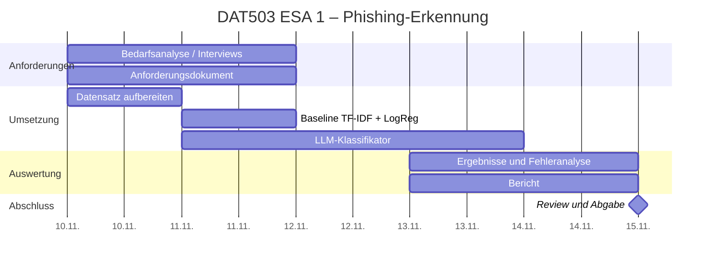

# Projektplan

Zeitraum: **10.11.2026 – 15.11.2026** (Abgabe 15.11.2026, 23:59)

## 1. Meilensteine

| # | Meilenstein | Fällig | Ergebnis |
|---|---|---|---|
| M1 | Thema und Anforderungen abgestimmt | 11.11. | `01_Anforderungsdokument.md` v1.0 |
| M2 | Datensatz und Baseline reproduzierbar | 11.11. | `make all` läuft durch, `results/metrics.json` |
| M3 | LLM-Vergleich durchgeführt | 13.11. | `results/llm_metrics.json` |
| M4 | Ergebnisse ausgewertet, Bericht fertig | 14.11. | `05_Ergebnisse.md` |
| M5 | Review, Protokoll vollständig, Abgabe | 15.11. | Abgabe im Moodle |

## 2. Gantt-Diagramm

## 3. Rollen und Verantwortlichkeiten (RACI)

R = durchführend, A = verantwortlich, C = konsultiert, I = informiert.
*Namen nach Gruppeneinteilung eintragen.*

| Aufgabe | Lucas Frank | *[Mitglied 2]* | *[Mitglied 3]* |
|---|---|---|---|
| Requirements Engineering | *[ ]* | *[ ]* | *[ ]* |
| Projektmanagement / Protokoll | *[ ]* | *[ ]* | *[ ]* |
| Datenaufbereitung, Baseline | *[ ]* | *[ ]* | *[ ]* |
| LLM-Vergleich | *[ ]* | *[ ]* | *[ ]* |
| Bericht, Präsentation | *[ ]* | *[ ]* | *[ ]* |

## 4. Kommunikationsstrategie

| Was | Wie | Wann |
|---|---|---|
| Kurzes Status-Update | *[Kanal eintragen, z. B. Teams/WhatsApp]* | täglich bis 20:00 |
| Abstimmungsmeeting (online) | *[Tool]* | 11.11. und 14.11., je 30 Min. |
| Code und Dokumente | GitHub-Repo (Pull Requests, Issues) | laufend |
| Entscheidungen | Eintrag im Projektprotokoll | sofort |

## 5. Risikomanagement

| Risiko | Wahrsch. | Auswirkung | Maßnahme | Status |
|---|---|---|---|---|
| Datenquellen nicht erreichbar (Hugging Face, Kaggle) | hoch | hoch | Datensätze aus GitHub-Repos mit fixem Commit | **eingetreten, gelöst** |
| Modell lernt die Datenquelle statt Phishing (Shortcut Learning) | hoch | hoch | Merkmalsanalyse, Variante B, OOD-Test | **eingetreten, teilweise gelöst** |
| Datenleck durch Anonymisierungs-Platzhalter | mittel | hoch | Top-Merkmale prüfen, Platzhalter normalisieren | **eingetreten, gelöst** |
| Kein API-Zugang oder Budget für das LLM | mittel | mittel | Skript mit Cache; Lauf durch Teammitglied mit Key | offen |
| Zeitmangel (5 Tage) | hoch | mittel | Scope klein halten, LLM-Stichprobe statt Volltest | aktiv |
| Ungleiche Arbeitsverteilung im Team | mittel | mittel | RACI, Beiträge im Protokoll und in der Git-Historie | aktiv |
| Datenschutz bei echten Mails | niedrig | hoch | nur öffentliche Datensätze | vermieden |
